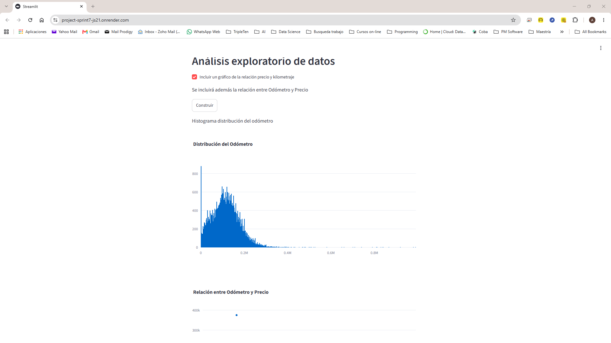

# Revision Notes

The following changes and checks were completed after the first project review.

## README

The README.md file was updated to include the correct public Render URL:

https://project-sprint7-js21.onrender.com

The README also includes:

- A description of the general purpose of the application.
- A description of the histogram showing the distribution of vehicle mileage.
- A description of the scatter plot showing the relationship between mileage and vehicle price.
- A brief explanation of the application's interactive functionality.

## Render Deployment

The application has been deployed successfully on Render and is accessible through the public URL above.

The application was tested from my side and both Plotly visualizations are displayed correctly.

The screenshot below shows the application running from the public Render deployment.

